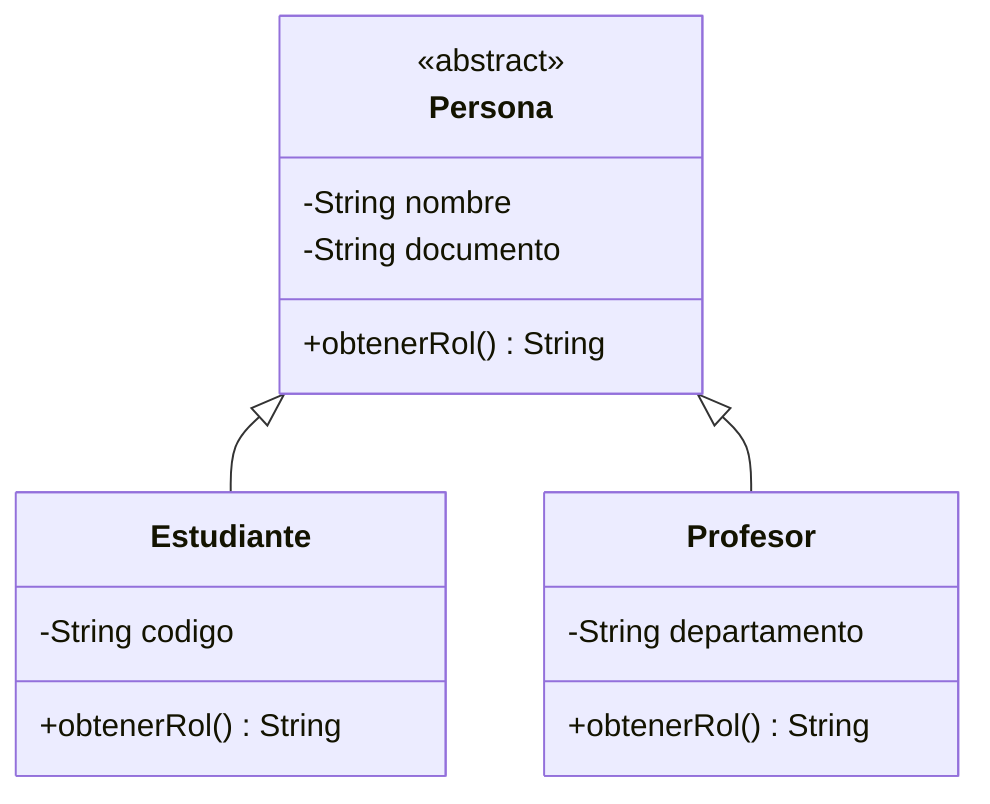
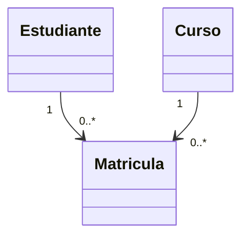

# Taller POO: Relaciones entre clases

**Lenguaje:** Java  
**Tema:** Sistema universitario  
**Propósito:** mostrar herencia, clase abstracta, interfaz, dependencia y asociación muchos a muchos.

## Requisitos
- JDK instalado.
- NetBeans, IntelliJ IDEA o un editor compatible con Java.

## Cómo ejecutar
1. Abre NetBeans y crea un proyecto Java llamado `TallerPOORelaciones`.
2. Copia los archivos de `src` al paquete principal del proyecto.
3. Ejecuta `Main.java`.
4. Si NetBeans crea una declaración `package ...;`, agrega esa misma declaración al inicio de todos los archivos Java.

## Conceptos incluidos
1. **Herencia:** `Estudiante` y `Profesor` extienden la clase abstracta `Persona`.
2. **Clase abstracta:** `Persona` reúne atributos comunes y declara `obtenerRol()` como método abstracto.
3. **Interfaz:** `Calificable` establece el método `calcularNotaFinal()`, implementado por `EstudianteCalificable`.
4. **Dependencia:** `ReporteAcademico` usa un objeto `Estudiante` como parámetro para generar un reporte.
5. **Asociación muchos a muchos:** estudiantes y cursos se relacionan mediante la clase asociativa `Matricula`.

## Diagrama de herencia (Mermaid)

## Diagrama de asociación muchos a muchos

## Enlace del repositorio
Después de crear el repositorio en GitHub, pega aquí su URL:
**[PEGAR AQUÍ EL ENLACE DEL REPOSITORIO]**

## Autor
Nombre: [Escribe tu nombre completo]  
Asignatura: Programación Orientada a Objetos  
Universidad: [Escribe el nombre de tu universidad]
